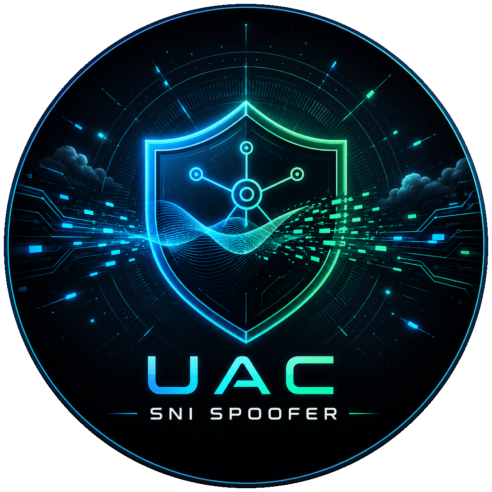
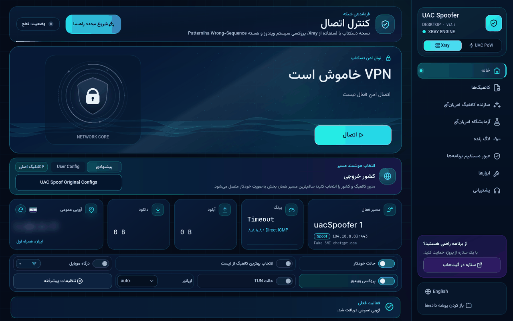
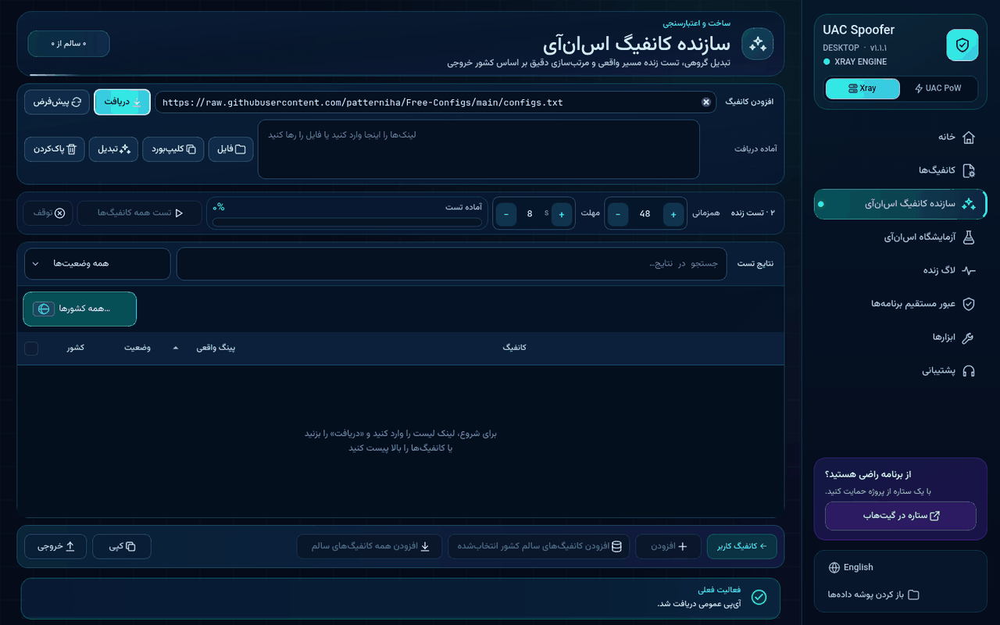
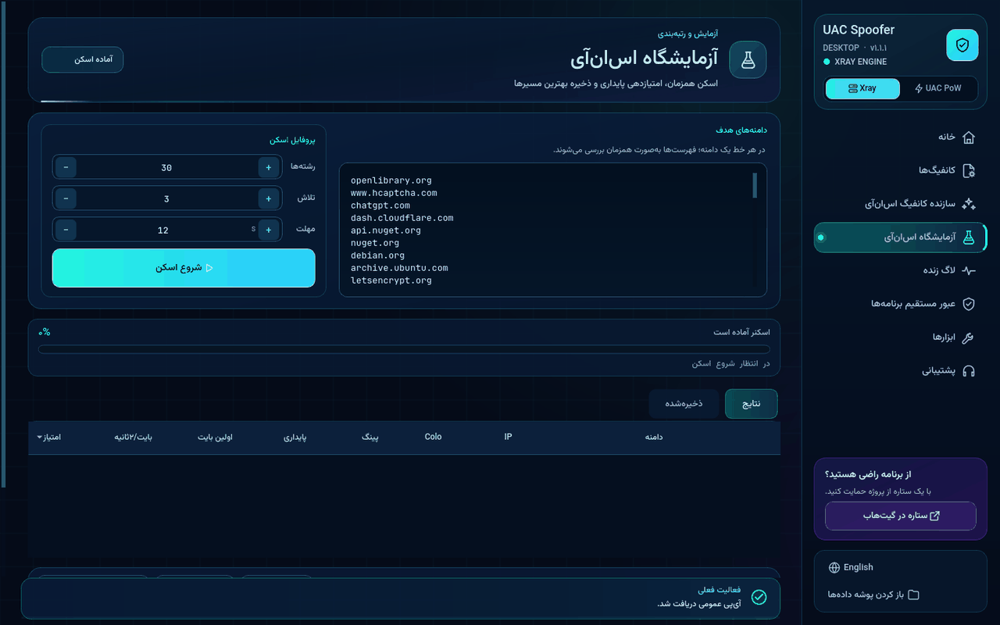
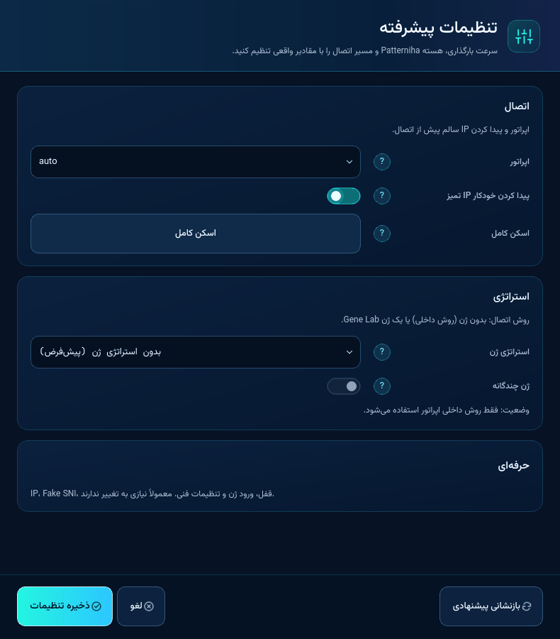
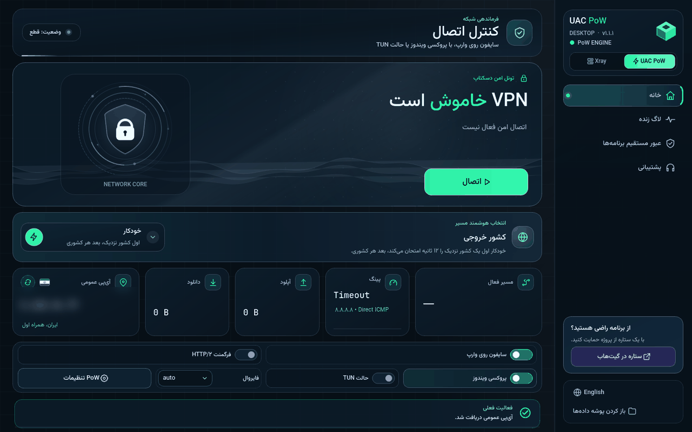
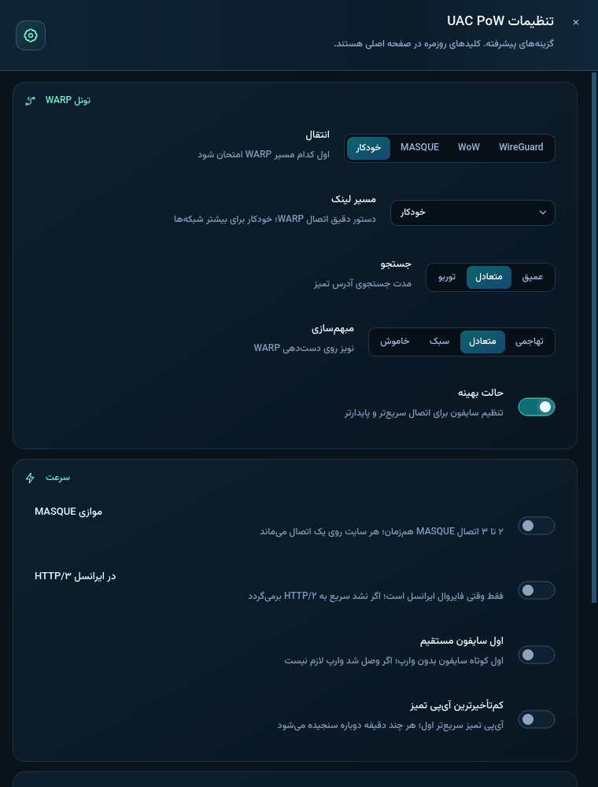
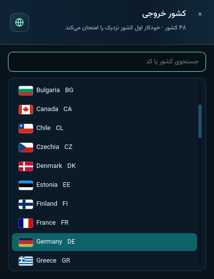

<div align="center">



# UAC SNI Spoofer — Windows

<p dir="rtl"><b>داشبورد شبکه یک‌کلیکی برای ویندوز: <code>Xray</code> با متد SNI Spoofing گروه Patterniha، به‌همراه موتور دوم سایفون روی وارپ</b></p>

[](https://github.com/Floxu1/UAC-SNI-Spoofer-Windows/releases)
[](#دانلود-و-شروع-سریع)
[](LICENSE)
[](https://github.com/Floxu1/UAC-SNI-Spoofer-Windows/releases/latest)
[](https://github.com/Floxu1/UAC-SNI-Spoofer-Windows/releases)

<p dir="rtl"><b>فارسی</b> · <a href="./README.en.md">English</a> · <a href="https://floxu1.github.io/UAC-SNI-Spoofer-Windows/">آموزش قدم‌به‌قدم</a> · <a href="https://t.me/UacSniSpoofer">کانال تلگرام</a></p>



</div>

<div dir="rtl">

## فهرست

- [معرفی](#معرفی)
- [قابلیت‌ها](#قابلیتها)
- [موتور ۱ — Xray و SNI Spoofing](#موتور-۱--xray-و-sni-spoofing)
- [موتور ۲ — UAC PoW سایفون روی وارپ](#موتور-۲--uac-pow-سایفون-روی-وارپ)
- [دانلود و شروع سریع](#دانلود-و-شروع-سریع)
- [ساخت از سورس](#ساخت-از-سورس)
- [پرسش‌های رایج و رفع مشکل](#پرسشهای-رایج-و-رفع-مشکل)
- [تازه‌های نسخه ۱.۱.۲](#تازههای-نسخه-۱۱۲)
- [قدردانی](#قدردانی)
- [مجوز](#مجوز)

## معرفی

‏UAC SNI Spoofer Windows دو موتور کامل تونل را در یک برنامه دوزبانه (فارسی و انگلیسی، با چیدمان راست‌به‌چپ و چپ‌به‌راست) کنار هم قرار می‌دهد:

| | موتور ۱ — <code>Xray</code> | موتور ۲ — <code>UAC PoW</code> |
|---|---|---|
| هسته | <code>Xray</code> + هسته SNI Spoofing گروه Patterniha | <code>aether</code> (‏WARP / MASQUE) + <code>Psiphon</code> |
| نیاز به کانفیگ | دارد (لیست پیشنهادی، کانفیگ خودتان یا سازنده کانفیگ) | ندارد |
| مناسب برای | خطوط همراه اول و ایرانسل با فیلترینگ SNI | خطوطی که کانفیگ‌ها مدام از کار می‌افتند |

هر دو موتور پروکسی ویندوز را خودکار تنظیم می‌کنند و هنگام قطع اتصال، خروج یا بعد از کرش، وضعیت قبلی پروکسی و شبکه را بازمی‌گردانند.

## قابلیت‌ها

**اتصال و مسیردهی**
- پروفایل‌های کاملاً جدا برای **همراه اول**، **ایرانسل** و حالت **خودکار**؛ تغییر یکی هرگز دیگری را خراب نمی‌کند.
- تونل محلی <code>SOCKS</code> و <code>HTTP</code> و تنظیم خودکار **پروکسی ویندوز** با بازگردانی امن.
- **حالت TUN** سراسری با <code>sing-box</code> برای ترافیک TCP و UDP؛ پیش از اعلام اتصال، مسیر واقعی یوتیوب بررسی می‌شود و <code>ping</code> مستقیم می‌ماند تا تأخیر واقعی نمایش داده شود.
- **درگاه موبایل** (‏Mobile Gateway): اشتراک اتصال با گوشی‌های همان شبکه، بدون تنظیم پروکسی یا آی‌پی ثابت روی گوشی، با لیست زنده دستگاه‌ها.
- **عبور برنامه‌ها** (‏App Bypass): برنامه‌های انتخابی مستقیم وصل می‌شوند (در حالت TUN هم به قانون <code>sing-box</code> تبدیل می‌شود).
- **سایت‌های ایرانی مستقیم** (به‌طور پیش‌فرض روشن): دامنه‌ها و آی‌پی‌های ایرانی از تونل رد نمی‌شوند.
- **‏Mux به‌طور پیش‌فرض خاموش** است، چون طبق اندازه‌گیری مسیرهای SNI و ECH را خراب می‌کند؛ همچنان از تنظیمات قابل روشن‌شدن است.

**پیدا کردن مسیر سالم**
- **دستیار شروع سریع**: اپراتور و رفتار فیلترینگ خط شما را تشخیص می‌دهد و کانفیگ سالم را پیدا و ذخیره می‌کند.
- **حالت خودکار با انتخاب کیفیت**: بهترین گزینه‌ها را هم‌زمان تست می‌کند و بر اساس بارگذاری واقعی صفحه و سرعت انتخاب می‌کند، نه فقط پینگ.
- **سازنده کانفیگ** (‏SNI Maker): لیست عمومی (پیش‌فرض لیست Patterniha) را می‌گیرد، همه را از داخل تونل واقعی تست می‌کند و سالم‌ها را نگه می‌دارد؛ با فیلتر کشور.
- **‏SNI Lab** و جستجوگر SNI هوشمند بر اساس اپراتور، با تست‌های واقعی روی هر لبه.
- **یابنده آی‌پی تمیز**: لبه‌های سالم قبلی Cloudflare را دوباره تست می‌کند و سپس رنج‌ها را با یک ClientHello واقعی بررسی می‌کند.
- **کلیدهای ECH**: دریافت هم‌زمان از چند ریزالور و ذخیره برای هر دامنه.
- **وارد کردن Gene Lab**: فایل <code>strategies.json</code> را وارد تنظیمات Pattern می‌کند، با استخر چندژنی یادگیرنده.

**رابط کاربری و عیب‌یابی**
- کارت آی‌پی عمومی با پرچم، اپراتور و ASN، شهر و منطقه زمانی (جستجوی سریع از چند منبع با حافظه موقت).
- کارت مسیر فعال (کانفیگ، کشور، آی‌پی لبه، Fake SNI، نوع Spoof یا ECH) و آمار زنده دانلود، آپلود و تأخیر.
- **لاگ زنده** خوانا و گروه‌بندی‌شده با خلاصه اتصال.
- پنجره‌های **تنظیمات** ساده و حرفه‌ای (مسیر، SNI، DNS، مهلت‌ها، Fallback و هسته Pattern).
- تأیید پیش از تعویض موتور هنگام اتصال، راهنماهای یک‌باره روی صفحه و بررسی نسخه جدید از GitHub Releases.
- **بازنشانی یک‌باره نسخه ۱.۱.۱**: داده‌های قبلی حذف نمی‌شوند؛ به پوشه <code>UAC Spoofer Desktop.backup-before-1.1.1-&lt;time&gt;</code> در <code>%APPDATA%</code> منتقل می‌شوند تا برنامه تمیز و با دستیار شروع شود.

## موتور ۱ — Xray و SNI Spoofing

‏<code>Xray</code> ترافیک را از هسته Patterniha عبور می‌دهد؛ این هسته دست‌دهی TLS را با یک Fake SNI به سمت یک لبه تمیز Cloudflare پنهان می‌کند.

<table>
<tr>
<td width="50%" valign="top" align="center"><br><sub>سازنده کانفیگ</sub></td>
<td width="50%" valign="top" align="center"><br><sub>آزمایشگاه SNI</sub></td>
</tr>
<tr>
<td width="50%" valign="top" align="center"><br><sub>تنظیمات</sub></td>
<td width="50%" valign="top" align="center"><br><sub>دستیار شروع سریع</sub></td>
</tr>
</table>

## موتور ۲ — UAC PoW سایفون روی وارپ

بدون نیاز به کانفیگ: <code>aether</code> یک مسیر WARP (با MASQUE یا WireGuard و جستجوی آی‌پی تمیز) می‌سازد و <code>Psiphon</code> از داخل آن عبور می‌کند. کشور خروجی را انتخاب کنید یا روی «خودکار» بگذارید.

<table>
<tr>
<td colspan="2" align="center"><br><sub>صفحه خانه موتور ۲</sub></td>
</tr>
<tr>
<td width="50%" valign="top" align="center"><br><sub>تنظیمات موتور ۲</sub></td>
<td width="50%" valign="top" align="center"><br><sub>انتخاب کشور خروجی</sub></td>
</tr>
</table>

گزینه‌ها: سایفون روی وارپ (پیش‌فرض)، فرگمنت HTTP/2، چند اتصال هم‌زمان MASQUE، انتخاب کم‌تأخیرترین آی‌پی و اولویت سایفون مستقیم.

## دانلود و شروع سریع

۱. فایل <code>UAC-Spoofer-Desktop-v1.1.2-Windows-x64-portable.zip</code> را از **[صفحه Releases](https://github.com/Floxu1/UAC-SNI-Spoofer-Windows/releases/latest)** دانلود کنید (با <code>SHA256SUMS.txt</code> بررسی کنید).<br>
۲. کل فایل ZIP را استخراج کنید و پوشه <code>_internal</code> را کنار فایل اجرایی نگه دارید.<br>
۳. فایل <code>UAC-Spoofer-Desktop.exe</code> را اجرا کنید و پیام UAC ویندوز را تأیید کنید (دسترسی ادمین برای درایور Spoof، حالت TUN و درگاه لازم است).<br>
۴. دستیار شروع سریع را دنبال کنید و دکمه **اتصال** را بزنید.

نیازی به نصب پایتون نیست. آموزش کامل تصویری: **[floxu1.github.io/UAC-SNI-Spoofer-Windows](https://floxu1.github.io/UAC-SNI-Spoofer-Windows/)**

## ساخت از سورس

**پیش‌نیازها:** ویندوز ۱۰ یا ۱۱ نسخه x64، پایتون <code>3.11</code> یا <code>3.12</code>، <code>git</code>، <code>Go 1.26+</code>، <code>Rust 1.88+</code> (‏<code>cargo</code>) به‌همراه <code>cmake</code> و <code>NASM</code>.

</div>

```powershell
git clone https://github.com/Floxu1/UAC-SNI-Spoofer-Windows.git
cd UAC-SNI-Spoofer-Windows
powershell -ExecutionPolicy Bypass -File .\build.ps1
# -> dist\UAC-Spoofer-Desktop\UAC-Spoofer-Desktop.exe
```

<div dir="rtl">

اسکریپت <code>build.ps1</code> وابستگی‌های <code>requirements.txt</code> را نصب می‌کند، <code>install-engine.ps1</code> را اجرا می‌کند و سپس PyInstaller را. <code>install-engine.ps1</code> پوشه <code>bin</code> را پر می‌کند (اگر فایلی با نسخه درست وجود داشته باشد، دوباره ساخته نمی‌شود):

| فایل | منبع |
|---|---|
| <code>xray.exe</code>، <code>geoip.dat</code>، <code>geosite.dat</code> | ریلیز <code>Xray-core 26.3.27</code> با هش SHA-256 ثابت |
| <code>sing-box.exe</code>، <code>libcronet.dll</code> | ریلیز <code>sing-box 1.13.14</code> با هش SHA-256 ثابت |
| <code>uac-psiphon.exe</code> | ساخت با <code>go build</code> از پوشه <code>pow_helper</code> (وابستگی‌ها با <code>go.sum</code>) |
| <code>aether.exe</code> | ساخت با <code>cargo build</code> از <code>core/aether</code> مخزن [UAC-SNI-Spoofer-Android](https://github.com/Floxu1/UAC-SNI-Spoofer-Android) در یک کامیت ثابت (یا مسیر <code>UAC_AETHER_SRC</code>) |

اجرای مستقیم از سورس: <code>pip install -r requirements.txt</code>، سپس <code>install-engine.ps1</code> و در آخر <code>python main.py</code>.

## پرسش‌های رایج و رفع مشکل

<details><summary><b>موتور ۱ وصل نمی‌شود.</b></summary>

دستیار شروع سریع را دوباره اجرا کنید، اپراتور را دستی انتخاب کنید و حالت خودکار را امتحان کنید. با سازنده کانفیگ یا یابنده آی‌پی تمیز مسیرها را تازه کنید. اگر کانفیگ‌ها مدام از کار می‌افتند، موتور ۲ را امتحان کنید.
</details>

<details><summary><b>کدام حالت پروکسی را انتخاب کنم؟</b></summary>

‏<code>Windows Proxy</code> برای مرورگرها و بیشتر برنامه‌ها کافی است. برای بازی‌ها و برنامه‌هایی که پروکسی سیستم را نمی‌شناسند از <code>TUN</code> استفاده کنید.
</details>

<details><summary><b>پینگ در CMD تأخیر واقعی را نشان می‌دهد؛ یعنی تونل خاموش است؟</b></summary>

خیر. ICMP از SOCKS، VLESS و Trojan عبور نمی‌کند، به همین دلیل <code>ping</code> عمداً مستقیم ارسال می‌شود.
</details>

<details><summary><b>بعد از به‌روزرسانی به ۱.۱.۱ تنظیمات قبلی‌ام نیست.</b></summary>

این بازنشانی یک‌باره نسخه ۱.۱.۱ است. همه‌چیز به پوشه <code>UAC Spoofer Desktop.backup-before-1.1.1-&lt;time&gt;</code> در <code>%APPDATA%</code> منتقل شده و چیزی حذف نشده است. این کار دیگر تکرار نمی‌شود.
</details>

<details><summary><b>بعد از کرش برنامه اینترنت کار نمی‌کند.</b></summary>

برنامه را یک بار باز و سپس خارج کنید؛ وضعیت ذخیره‌شده پروکسی و درگاه ویندوز خودکار بازگردانده می‌شود.
</details>

## تازه‌های نسخه ۱.۱.۲

- دریافت خودکار کلید WARP با مسیر ‏OOB (‏<code>keyfetch-net</code> / SChannel) برای شبکه‌هایی مثل AS48944؛ محافظ TUN و رزرو پورت پروکسی.
- موتور دوم **‏UAC PoW** (سایفون روی وارپ) با تنظیمات، انتخاب کشور خروجی و گزینه‌های سرعت.
- دستیار شروع سریع، راهنماهای روی صفحه و سایت آموزش تصویری کامل.
- انتخاب حالت خودکار بر اساس کیفیت واقعی (بارگذاری صفحه و سرعت) بین گزینه‌های تست‌شده هم‌زمان.
- عبور مستقیم سایت‌های ایرانی و خاموش بودن Mux به‌طور پیش‌فرض.
- نمایش سریع‌تر آی‌پی عمومی (چند منبع، با حافظه موقت).
- یابنده آی‌پی تمیز، حافظه کلید ECH، جستجوگر SNI و وارد کردن Gene Lab.
- بازنشانی یک‌باره داده‌ها برای شروع تمیز (داده‌های قبلی به پوشه پشتیبان منتقل می‌شوند).
- ساخت کامل از یک کلون تازه (شامل <code>aether</code> و <code>uac-psiphon</code>) فقط با <code>build.ps1</code>.

## قدردانی

- تشکر ویژه از گروه **Patterniha** برای ابداع و معرفی این متد SNI Spoofing. سورس اصلی و مجوز GPL-3.0 آن در <code>third_party/patterniha_sni_spoofing/</code> قرار دارد.
- ‏[**Xray-core**](https://github.com/XTLS/Xray-core): هسته تونل.
- ‏[**sing-box**](https://github.com/SagerNet/sing-box) نسخه <code>1.13.14</code> از SagerNet: حالت TUN؛ مجوز آن در <code>bin/sing-box-LICENSE</code> همراه برنامه است.
- ‏[**Psiphon tunnel-core**](https://github.com/Psiphon-Labs/psiphon-tunnel-core): لایه داخلی موتور ۲ (‏<code>pow_helper</code>).
- ‏**aether**: کلاینت WARP و MASQUE از مخزن [UAC-SNI-Spoofer-Android](https://github.com/Floxu1/UAC-SNI-Spoofer-Android) با مجوز AGPL-3.0-only.

## مجوز

این پروژه تحت مجوز **GNU General Public License v3.0** منتشر شده است؛ متن کامل در [LICENSE](LICENSE) و [NOTICE](NOTICE). استفاده، مطالعه و تغییر نرم‌افزار آزاد است، اما نسخه‌های تغییر‌یافته‌ای که منتشر می‌شوند باید تحت همان مجوز GPL-3.0 باشند و سورس آن‌ها در دسترس قرار گیرد. اعتبار گروه Patterniha نباید از این پروژه یا نسخه‌های مشتق حذف شود.

</div>

<div align="center"><sub>Copyright © 2026 Floxu1</sub></div>
